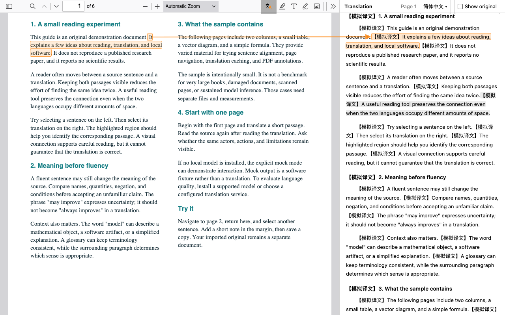
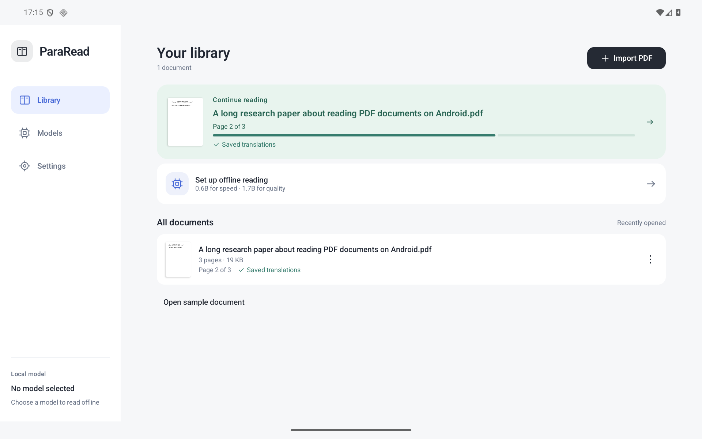
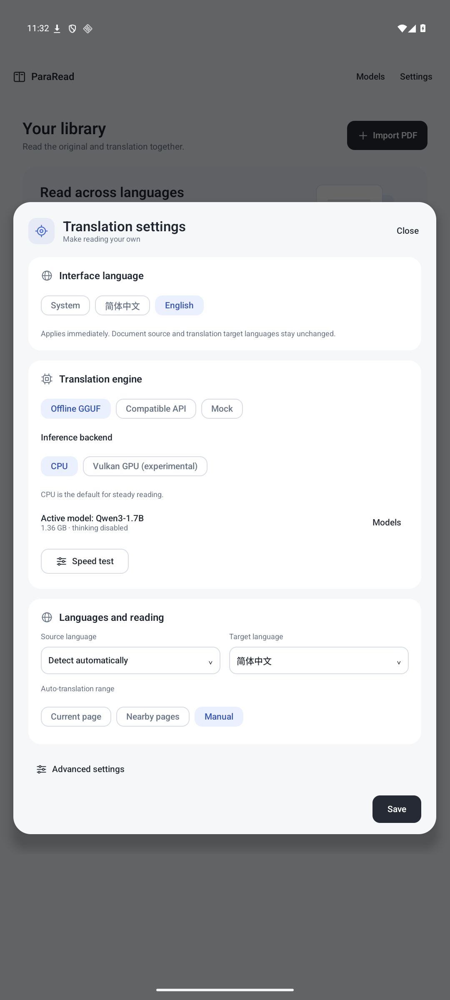

<p align="center"></p>

<h1 align="center">ParaRead Android</h1>
<p align="center"><strong>Your PDF. Two languages. One place to read.</strong></p>

Read papers and technical documents with the original page beside its translation. Follow a sentence, check a formula, and keep the context — with local AI running on your Android device.

[](https://github.com/kejie-tang/pararead-android/actions/workflows/android.yml) [](#get-started) [](LICENSE)

**[Download APK](https://github.com/kejie-tang/pararead-android/releases/tag/v0.2.0-alpha.13)** · [All releases](https://github.com/kejie-tang/pararead-android/releases) · [简体中文](README.zh-CN.md)

A development preview for **Android 9+ / ARM64**, designed for tablets and usable on phones. Native menus support **English and Simplified Chinese**, with a system-language option. Independent, unofficial adaptation of [ParaRead](https://github.com/Chuanyunux/pararead) 0.6.1.



*Reading interaction demo in desktop Chromium with touch emulation. Uses our original sample document and labeled Mock output; this is not a real-model or physical-tablet screenshot.*

## Made for reading, not copying and pasting

- **Keep the page intact.** See figures, equations and references while reading the translation beside the PDF.
- **Follow the same sentence.** Tap either side for matching highlights, alignment and linked scrolling.
- **Read offline.** Download a GGUF once and translate on-device through llama.cpp. No Ollama app or account is required.
- **Read at your pace.** Translate a selection, a page or the whole document. Validated translations and page checkpoints let you continue later.
- **Make it yours.** Keep annotations, export an annotated PDF, customize terminology and choose your translation language.
- **Manage models easily.** Download, switch or delete models; search Hugging Face when you want more choices.

<details>
<summary>See the Android interface</summary>

<p></p>
<p></p>

Actual Android emulator captures. The original book icon is included as an adaptive launcher icon with a themed monochrome variant.

</details>

## Get started

1. **Install the [preview APK](https://github.com/kejie-tang/pararead-android/releases/tag/v0.2.0-alpha.13).** Requires ARM64, Android 9+ and an up-to-date Android System WebView. The preview signing identity is retained for in-place upgrades; see the [validation and upgrade notes](docs/reports/alpha13.md). Do not uninstall an existing installation just to bypass a signature error; uninstalling deletes private documents, translations and models.
2. **Choose a model in Models.** Start with 0.6B for quick reading or 1.7B for stronger translations. Downloads are verified before activation; existing models are retained.
3. **Import a PDF or open the sample.** Tap a sentence, translate **This page**, or use **All / Resume**. PDFs need selectable text; OCR is not included.

Change native menu language in **Settings → Interface language**. This applies immediately and stays separate from **Source language** and **Target language**. The embedded PDF viewer and raw third-party diagnostics may retain their own language.

### Restore translations and read full screen

- Reopening a PDF automatically restores saved translations, including in **manual** mode, without calling the model or API. Automatic modes translate only cache misses; manual mode leaves them untranslated until you explicitly translate.
- Tap **Full screen** in the reading toolbar to hide the app navigation, toolbar, status messages and system bars. In alpha.13, swiping up to continue reading hides both PDF and translation headers; swiping down or tapping the small arrow restores them. Controls stay visible during annotation, sentence/text selection, and zoom gestures. Normal reading keeps its toolbar. Use the bottom-right exit button or Android Back to leave full screen; Back again returns to the library. The preference persists, and toggling does not recreate the reader or interrupt translation.
- Cached translations are separated by source text and translation configuration (including model, language and glossary). They stay in app storage and are not embedded in exported annotated PDFs.

### Pick your model

| Model | Best fit | Download | Free space for a new download¹ |
| --- | --- | ---: | ---: |
| **Qwen3-0.6B Q4_K_M** | Quick reading and preview | 397 MB | About 464 MB |
| **Qwen3-1.7B Q4_K_M** | Quality priority; current default | 1.36 GB | About 1.43 GB |

¹ Model size plus a 64 MiB reserve, excluding PDFs and other saved models. Alpha.11 downloads directly into a temporary file beside the model, verifies GGUF/size/SHA-256 and renames it into place. **A second full weight copy is no longer needed.** Background work, network retry and HTTP Range resume are supported; completion is registered when the app observes the finished task. Older in-flight system downloads finish through the legacy installation path. [Implementation and checks](docs/reports/alpha11.md).

The 0.6B file comes from a pinned Unsloth Hugging Face revision; 1.7B uses a pinned Ollama registry layer. Thinking is disabled. Other public, single-file text GGUFs can be found under **Models → More models on Hugging Face**. Current templates cover Qwen2.5, Qwen3, Qwen3.5 and LFM2/2.5. Model licenses are shown separately from the app license. [Exact files and compatibility results](docs/reports/small-model-evaluation.md).

Small models can omit details or mistranslate numerical relations. Format validation and retries help recover malformed output; they do not establish translation accuracy. Check important claims against the source.

### Performance you can measure

Use **Settings → Offline GGUF → Speed test** for four long-paragraph translations and three raw **pp512 / tg128** engine runs. The app records native token counts, cold/warm timing, CPU plugin, thread count and backend; export the complete JSON for comparison.

A user reported **26 token/s for translation and 23 token/s for tg128** on **Dimensity 9400, Qwen3 1.7B Q4_K_M, CPU / 6 threads**, following the CPU optimizations. This is one device report without a raw export, not a cross-device benchmark. [CPU investigation and limits](docs/reports/cpu-threadpool.md).

CPU is the default. Instruction-specific CPU plugins and persistent worker reuse are automatic. Vulkan is experimental, with CPU fallback on failure; it can be slower or cause UI stutter on some devices. [Backend details](docs/vulkan.md).

## Your documents stay under your control

- **Local mode:** document text is processed on-device. Downloading a model needs internet; translation does not use a remote service. There is no automatic cloud fallback.
- **API mode:** selected text and prompts go to the endpoint you configure. Remote servers require HTTPS; local HTTP is supported.
- **Storage:** imported PDFs, annotations, reading state, translations and models live in app-owned storage. Updating with the same signature retains them. **Uninstalling or clearing app data removes them**; export annotated PDFs you want to keep. Deleting a model leaves PDFs and translations intact.

The included six-page [sample guide](samples/pararead-reading-guide.pdf) is original Apache-2.0 material. To try *Attention Is All You Need*, download it from the [official arXiv page](https://arxiv.org/abs/1706.03762) and import your copy. That paper is not bundled or relicensed by this project.

## Build and contribute

Requirements: **Node.js 24+**, **Python 3.9+**, **JDK 21**, **Android SDK 36**, **NDK 28.2.13676358**, **CMake 3.22.1**, plus `glslc` and Ninja. Configure `JAVA_HOME` and `ANDROID_HOME`.

```sh
npm ci
python3 scripts/fetch_upstream.py
python3 scripts/fetch_llama.py
./gradlew :app:assembleDebug
adb install -r app/build/outputs/apk/debug/app-debug.apk
```

On macOS, use `scripts/gradle.sh` instead of `./gradlew`; install the shader compiler with `brew install shaderc`. On Ubuntu: `apt-get install glslc ninja-build`. Source dependencies are pinned and verified; builds do not download model weights. [Build/backend guide](docs/local-llama.md) · [Signing and publishing](docs/publishing.md).

<details>
<summary>Checks and engineering notes</summary>

```sh
npm test
npm run check:reader
npm run test:android-web
npx playwright install chromium
npm run test:reader
./gradlew :core:test :engine:llama:testDebugUnitTest :app:lintDebug
```

Android instrumentation tests need an ARM64 device/emulator. Opt-in model tests need their documented local fixtures. `-PskipNative` builds a Mock-only prototype.

[Architecture](docs/architecture.md) · [Compatibility and limits](docs/compatibility.md) · [Performance](docs/performance.md) · [Whole-document recovery](docs/reports/whole-document-recovery.md) · [Model research](docs/reports/mid-small-models.md) · [Latest validation](docs/reports/alpha11.md). Many detailed engineering notes are in Chinese.

</details>

This remains a development preview. Sustained device workloads, accessibility, stylus behavior, unusual PDFs and academic translation quality need broader validation. [Report an issue](https://github.com/kejie-tang/pararead-android/issues) with your device, Android/WebView versions, model and reproduction steps; include a speed-test JSON where relevant.

## Credits and license

Built on **[ParaRead](https://github.com/Chuanyunux/pararead)** by Chuanyunux, whose notices credit **vscode-pdf** by Mathematic Inc and **Mozilla PDF.js**. Local inference uses **llama.cpp / ggml**, Arm KleidiAI and optional Vulkan. This adaptation adds the Android host, storage, translation scheduling, model management and JNI integration. The launcher artwork is original to this project.

Original Android code, adaptation changes and original artwork use **[Apache-2.0](LICENSE)**. Third-party components and separately downloaded models retain their own licenses. Preserve [NOTICE](NOTICE), [third-party disclosures](THIRD_PARTY_NOTICES.md) and [license originals](third_party/) with distributions. The app license does not grant rights to arbitrary PDFs, models or translations.

Independent and unofficial; no upstream project or model provider endorses this app. PocketPal and other apps were references for behavior and architecture; their code and assets were not copied. [Source and license review](docs/licenses.md).
