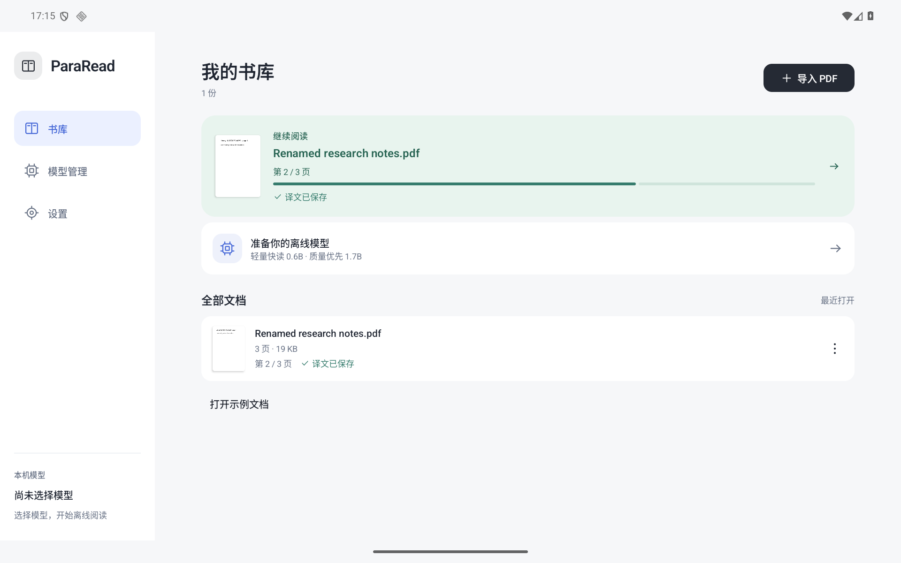
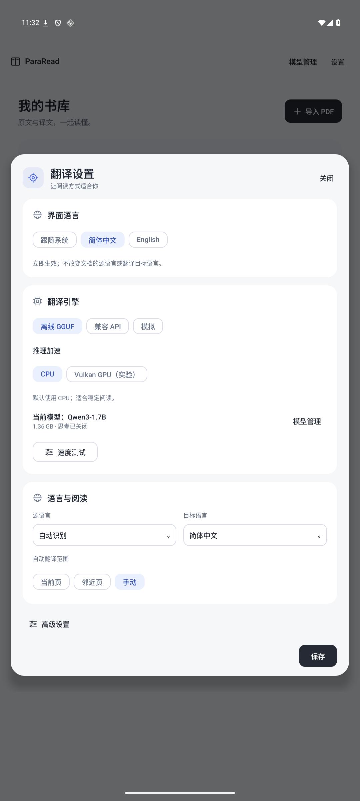

<p align="center"></p>

<h1 align="center">ParaRead Android</h1>
<p align="center"><strong>一份 PDF，两种语言，一起读懂。</strong></p>

在 Android 上对照阅读论文与技术文档：原始页面放在身边，译文逐句对应。查看公式、核对引用、理解上下文，让本地 AI 帮你读下去。

[](https://github.com/kejie-tang/pararead-android/actions/workflows/android.yml) [](#开始使用) [](LICENSE)

**[下载 APK](https://github.com/kejie-tang/pararead-android/releases/tag/v0.2.0-alpha.14)** · [全部版本](https://github.com/kejie-tang/pararead-android/releases) · [English](README.md)

面向 **Android 9+ / ARM64** 的开发预览版，为平板设计，也可在手机使用。原生菜单支持**简体中文、English 和跟随系统**。基于 [ParaRead](https://github.com/Chuanyunux/pararead) 0.6.1 的独立、非官方适配。


*阅读交互演示：桌面 Chromium 触摸模拟、自编示例文档和明确标注的 Mock 输出；不是实际模型译文或实体平板截图。*

## 把时间花在阅读上

- **保留页面上下文。** 原文中的图表、公式与引用始终可见，译文在一旁对照。
- **逐句找到对应内容。** 点击任意一侧，联动高亮、位置对齐与滚动。
- **离线也能翻译。** 下载一次 GGUF，通过 llama.cpp 在设备上推理，无需安装 Ollama 或注册账号。
- **按自己的节奏读。** 翻译选段、本页或全篇，保存校验通过的译文和逐页进度，下次继续。
- **适合你的阅读习惯。** 保存批注、另存批注 PDF，设置术语表与翻译语言。
- **方便管理模型。** 下载、切换、删除，也可在 Hugging Face 搜索其他模型。
- **接着上次的位置读。** 紧凑书库展示首页缩略图、阅读进度和译文保存状态，顶部继续阅读最近打开的 PDF，文档菜单支持重命名与删除。

<details>
<summary>查看 Android 界面</summary>

<p></p>
<p></p>

以上为 Android 模拟器实际截图。原创双页图标已用于启动器，并提供随系统配色的单色版本。

</details>

## 开始使用

1. **安装[预览版 APK](https://github.com/kejie-tang/pararead-android/releases/tag/v0.2.0-alpha.14)。** 需要 ARM64、Android 9+ 和较新的 Android System WebView。预览版沿用原签名以便覆盖升级；详见[验证与升级说明](docs/reports/alpha14.md)。不要为绕过签名错误直接卸载旧版，卸载会删除私有文档、译文缓存和模型。
2. **在“模型管理”选择模型。** 0.6B 适合轻量快读，1.7B 偏重译文质量。下载校验通过后自动启用，其他模型会保留。
3. **导入 PDF，或打开示例文档。** 点击句子、翻译“本页”，或使用“全篇 / 继续”。PDF 需要可选中文字，暂不提供 OCR。

在**设置 → 界面语言**切换原生菜单，即时生效，与“源语言”“目标语言”分别设置。内嵌 PDF 查看器及原始第三方诊断信息可能保留各自的语言。

### 恢复译文与全屏阅读

- 已完成并校验通过的译文自动保存在本地，退出 PDF 后重新打开会恢复显示，**手动翻译模式也能恢复，不会为了恢复而调用模型或 API**。自动模式只补译缺失句子；手动模式需点击句子或“本页 / 全篇”才翻译缺失内容。
- 点击阅读工具栏的**全屏**，隐藏左侧导航、顶部应用栏、状态信息和系统栏，alpha.13 中，上滑继续阅读时会收起 PDF 工具栏和译文顶部栏，下滑或点击小箭头恢复；批注、句子或文字选择及双指缩放时保持菜单显示。普通阅读模式保留工具栏。右下角按钮或 Android 返回键退出全屏，再按返回键回到书库。全屏偏好会保存，下次打开 PDF 时沿用；切换不会重建阅读器或中断翻译。
- 缓存按原文、模型、语言及术语表等配置区分。更换配置后不会套用旧配置的译文；译文保存在 App 数据中，不会自动写入导出的批注 PDF。

### 选择适合的模型

| 模型 | 适合场景 | 下载大小 | 新下载所需可用空间¹ |
| --- | --- | ---: | ---: |
| **Qwen3-0.6B Q4_K_M** | 快速浏览、预览 | 397 MB | 约 464 MB |
| **Qwen3-1.7B Q4_K_M** | 质量优先，当前默认 | 1.36 GB | 约 1.43 GB |

¹ 模型大小加 64 MiB 预留，不含 PDF 和其他已保存模型。Alpha.11 直接下载到模型目录的临时文件，检查 GGUF、大小和 SHA-256 后原地重命名，**不再需要第二份完整权重**。支持后台任务、网络重试和 HTTP Range 续传；App 观察到任务完成后登记并启用模型。升级前已在进行的系统下载仍通过旧安装流程完成。[实现与验证](docs/reports/alpha11.md)。

0.6B 来自固定提交的 Unsloth Hugging Face 文件；1.7B 来自固定摘要的 Ollama registry 模型层。默认关闭思考。在**模型管理 → 更多模型（Hugging Face）**中可查找公开的单文件文本 GGUF；当前模板适配 Qwen2.5、Qwen3、Qwen3.5 和 LFM2/2.5。模型许可单独展示。[精确文件与兼容性实测](docs/reports/small-model-evaluation.md)。

小模型仍可能漏译或翻错数字关系。格式校验和重试可以修复部分输出结构，无法保证语义准确；重要结论仍应对照原文。

### 在自己的设备上测速

打开**设置 → 离线 GGUF → 速度测试**，运行四次长段翻译和三次纯引擎 **pp512 / tg128**。结果记录原生 token 数、首次与热模型耗时、CPU 内核、线程数和实际后端，可导出完整 JSON。

CPU 优化后，用户在**天玑 9400、Qwen3 1.7B Q4_K_M、CPU / 6 线程**上反馈：**翻译 26 token/s，tg128 为 23 token/s**。这是尚未附带原始导出的一台设备反馈，不代表所有设备表现。[CPU 排查与测试边界](docs/reports/cpu-threadpool.md)。

默认使用 CPU，自动选择支持的指令内核并复用工作线程池。Vulkan 为实验选项，失败时回退 CPU；部分设备可能更慢或出现界面卡顿。[后端说明](docs/vulkan.md)。

## 文档由你掌握

- **本地模式：**设备上处理文档文字。下载模型需要网络，翻译不使用远程服务，也不会自动切换到云端。
- **API 模式：**选中的文字和提示会发送到你配置的端点；远程服务要求 HTTPS，本机服务支持 HTTP。
- **存储：**导入的 PDF、批注、阅读进度、译文与模型保存在 App 专属空间。相同签名覆盖升级会保留数据；**卸载或清除 App 数据会删除这些内容**，需要保留的批注 PDF 请先另存。单独删除模型会保留文档和译文。

内置六页[操作示例](samples/pararead-reading-guide.pdf)为本项目原创，采用 Apache-2.0。要尝试 *Attention Is All You Need*，请从 [arXiv 官方页面](https://arxiv.org/abs/1706.03762)下载后导入；本项目不打包或重新授权该论文。

## 构建与参与

需要 **Node.js 24+**、**Python 3.9+**、**JDK 21**、**Android SDK 36**、**NDK 28.2.13676358**、**CMake 3.22.1**，以及 `glslc`、Ninja；配置 `JAVA_HOME` 和 `ANDROID_HOME`。

```sh
npm ci
python3 scripts/fetch_upstream.py
python3 scripts/fetch_llama.py
./gradlew :app:assembleDebug
adb install -r app/build/outputs/apk/debug/app-debug.apk
```

macOS 请用 `scripts/gradle.sh` 替代 `./gradlew`，通过 `brew install shaderc` 安装着色器编译器；Ubuntu 使用 `apt-get install glslc ninja-build`。源码依赖固定版本并校验，构建不下载模型权重。[构建与后端](docs/local-llama.md) · [签名与发布](docs/publishing.md)。

<details>
<summary>检查命令与工程记录</summary>

```sh
npm test
npm run check:reader
npm run test:android-web
npx playwright install chromium
npm run test:reader
./gradlew :core:test :engine:llama:testDebugUnitTest :app:lintDebug
```

Android instrumentation 需要 ARM64 设备或模拟器；可选真模型测试需准备报告中指定的本机文件。`-PskipNative` 仅生成 Mock 原型。

[架构](docs/architecture.md) · [兼容性与限制](docs/compatibility.md) · [性能](docs/performance.md) · [全篇任务恢复](docs/reports/whole-document-recovery.md) · [小模型研究](docs/reports/mid-small-models.md) · [本次验证](docs/reports/alpha11.md)。

</details>

当前仍为开发预览版，持续负载、无障碍、手写笔、复杂 PDF 和学术翻译质量仍需更多设备验证。欢迎[反馈问题](https://github.com/kejie-tang/pararead-android/issues)，附上设备、Android/WebView 版本、模型及复现步骤；性能问题可附测速 JSON。

## 致谢与许可

基于 Chuanyunux 的 **[ParaRead](https://github.com/Chuanyunux/pararead)**；其声明感谢 Mathematic Inc 的 **vscode-pdf** 与 **Mozilla PDF.js**。本地推理使用 **llama.cpp / ggml**、Arm KleidiAI 和可选 Vulkan。本适配增加 Android 宿主、文件存储、翻译调度、模型管理与 JNI 集成；启动图标为本项目原创。

原创 Android 代码、适配修改及原创图形采用 **[Apache-2.0](LICENSE)**。第三方组件与单独下载的模型保留各自许可；分发时保留 [NOTICE](NOTICE)、[第三方声明](THIRD_PARTY_NOTICES.md)及[许可原文](third_party/)。App 许可证不授予任意 PDF、模型或译文的使用权。

本项目独立且非官方，不代表上游或模型提供方背书。PocketPal 等项目仅作行为与架构参考，未复制其代码或资产。[来源与许可核对](docs/licenses.md)。
