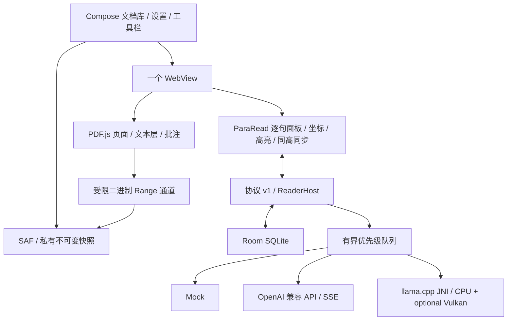

# ParaRead Android 架构

本文件更新为 Phase 2–5 集成开发版的实际架构。Phase 1 审查历史见 [source-audit.md](source-audit.md) 和 [phase-1.md](reports/phase-1.md)。真实 GGUF 已补充 macOS 共用 JNI、llama-server 和 Android ARM64 模拟器测试，见 [本机实测](local-llama.md)；实体平板未测。

## 模块与复用边界

- `:app`：Kotlin、Jetpack Compose、SAF、WebViewAssetLoader、Room、生命周期及保存。
- `:core`：协议解析、翻译配置/保护/验证、优先级队列、Mock、OkHttp SSE；可独立运行 JVM 测试。
- `:engine:llama`：原生单线程上下文所有权、GGUF 加载、UTF-8 流、取消；CMake 构建固定 llama.cpp。
- `web/reader/src/upstream`：从固定 ParaRead 提交复制的阅读模块。保留句子切分、spanRange/PDF rects、结构化译文、双向高亮、30% 阅读锚点、同高滚动和连接线。
- `bridge.ts` 将原 VS Code 消息适配至 Kotlin；`reading-order.ts` 在原分段器之后保守调整双栏块顺序，不重建句子 ID 或坐标。

工具链：JDK 21、Gradle 8.14.3、AGP 8.13.2、Kotlin 2.2.20、Compose BOM 2025.08.01、Room 2.7.2、WebKit 1.14.0。API 28 起，compile/target 36，仅 ARM64。llama.cpp 固定 `2280f0fd163b03d4331d49e08460f66502e35854`，NDK 28.2.13676358，CMake 3.22.1，CPU Release 优化，16KiB ELF 对齐；按需加载 Vulkan GPU 实验后端，CPU 默认；未启用 OpenMP；KleidiAI v1.32.0 通过运行时 CPU 特征检测选择内核。

Alpha.9 为普通 ggml CPU 算子补充分离的 dotprod、dotprod + FP16、dotprod + FP16 + i8mm 插件，保留基础 ARM64 插件。按上游基线编译的 feature score 拒绝不支持的插件，成功加载一个即停止；不探测 Vulkan，不打包 SVE/SME 插件。测速保存实际插件名。详见 [CPU 指令排查与验证](reports/cpu-kernel-dispatch.md)。

## ADR-01：保留单个 WebView 的原阅读语义

PDF 左、译文右共享 DOM 坐标。选句仍是一组 PDF 单位 rects 与文本层 span 索引；每句译文是所属结构块中的独立 span。标题/列表/段落/图表标题/注释/代码沿用上游 role，不改为整页纯文本。选中锚点保持同高；边界 clamp 沿用原版，不声称所有不同语言行能同时等高。

触屏使用短 tap；超过移动阈值、长按、pointercancel、多指手势不触发选句。鼠标和笔保留 250ms hover。进入批注编辑模式暂停阅读选句。竖屏保留双栏，分隔条扩大触摸范围；实体笔/鼠标行为尚待设备测试。

## ADR-02：原生消息权威与受限资产

资产位于 `https://appassets.androidplatform.net/reader/`。限定 origin 与 main frame 的 `addWebMessageListener` 接收 JSON，经 Kotlin 运行时解析；回复使用 reply proxy，不把原文拼接成 JavaScript。WebView 禁止 file/content 访问和混合内容；CSP 限定本地资源，PDF JavaScript 禁用，外链仅在用户点击后交给系统。

消息带 session、documentId、documentRevision、requestId、viewportEpoch 和 configRevision。JS 拦截旧 session、乱序 sequence、重复 terminal；Kotlin 核对会话/修订和有界字段。JSON 上限按 UTF-8 实际字节计算。模型私有路径和 API key 不进入 JS；key 使用 Android Keystore AES-GCM 保存。配置变更通过重建会话应用。

协议实际范围见 [bridge-protocol.md](bridge-protocol.md)。完整订阅去重、独立 engine-unresponsive watchdog、全部负向 WebView 测试未完成。

## ADR-03：SAF、不可变快照与随机读

所有 SAF 输入先流式复制为应用私有快照（256KiB 缓冲），计算 SHA-256，完成后重命名并登记 Room。与最初“可 seek URI 直接读取”的设计相比，本版统一复制以保证跨 provider、权限丢失、崩溃与批注 baseline 的稳定性；代价是完整导入时间与额外磁盘占用。支持未知长度/pipe 的顺序输入；不把完整 PDF 放入内存。

`RangeSource` 使用 positional FileChannel.read 与 Long 偏移，不共享 seek 游标。范围端点绑定随机 token，最多 256KiB/响应，验证边界/短读。JS `PDFDataRangeTransport` 拆分合并请求，最多 4 个在途 fetch；不使用完整 PDF JSON/base64/Blob URL。3GiB 稀疏文件测试验证 >2GiB 偏移、并发读和原文件/批注尾部的交叉边界。

## ADR-04：稀疏 PDF.js 字节缓存（G1 实现，广泛验收仍开放）

Phase 1 发现 PDF.js ChunkedStream 会预分配全文 Uint8Array。本版以固定源码补丁替换为 256KiB chunk Map，64MiB LRU；淘汰同步撤销 loadedChunks 与快速命中状态，缺失字节触发 MissingDataException 重读。修正子流创建、DataLoaded、连续 buffer 访问与保存调用，禁止 GetData 全文读取；补丁不匹配固定源时构建失败。

单次连续对象/合并范围上限 16MiB。需要全文恢复扫描的损坏 PDF 或超出此预算的对象会报错，不能声称对全部 PDF 兼容。三档合成有效文字 PDF 已在 ARM64 模拟器渲染和跳页；parser/xref/object-stream 的复杂回归、真实论文与模型同跑内存仍待完成。

PDF.js 页缓存缩至 4、每 canvas 最大 4M 像素。SentenceStore、面板 DOM 与译文状态按当前页 ±5 页淘汰，全篇任务逐页生产并主动淘汰；页提取后写 Room。64MiB 仅是源字节缓存预算，不是 renderer 总 PSS 或模型内存预算。

## ADR-05：真正的增量 PDF 保存（G2 基础路径通过）

复用 PDF.js 的增量 writer，修改 SaveDocument 不再 requestLoadedStream；`incrementalUpdate` 按原文件长度计算偏移，但只返回新增 suffix。编辑器批注仅保存实际编辑页，避免原版对全部页并发Page.save。表单字段修改保留≤512页旧路径，超出明确报错。最多16MiB suffix，24KiB base64消息分块传输；这里传的是批注增量，PDF 原文不进入消息桥。

原生端 fsync suffix，以 Room 登记私有可恢复草稿；重开时 RangeSource 视为“原快照 + 增量尾部”。另存时以 256KiB 缓冲复制 baseline 并追加 suffix，经 SAF 创建真正 PDF。原文件保持不可变。反复保存从本会话 baseline 生成，避免重复追加；保存失败保留 dirty，持久化确认后才 resetModified。批注哈希观察与保存排队处理保存过程中的后续编辑。

真实 PDF.js 文字批注已保存并重新解析，模拟器重建 Activity 后恢复成功。高亮/墨迹交互来自原版 PDF.js，但未完成实体笔、复杂加密/xref/对象流、三档大 PDF 保存及独立阅读器复核。私有草稿不等于已导出；“另存成功”才代表用户选择的目标写入完成。

## ADR-06：Room 与缓存身份

schema v1 导出到 `app/schemas/`。实体为 DocumentRecord、TranslationRecord、PageRecord、ReadingRecord、DraftRecord、JobRecord、PerformanceRecord。

译文键包含 NFC/空白规范化原文、provider、模型名/实际 GGUF SHA（API 为端点指纹）、源/目标语言、规范术语 JSON、prompt/validator/template 版本；不包含页面坐标，因此可复用同文内容。仅完整验证结果入库，DB commit 在 committed 事件之前。页坐标缓存键为 revision/page/segmenterVersion=2；超 60KB 的缓存页回复暂回退重提取，页分块总上限另见协议。

阅读页、位置 hash、真实 scale 值、rotation、面板状态、最近选句持久化。Renderer 重建创建新会话并恢复已持久数据。schema v1 还没有历史版本迁移；VS Code 分片缓存导入与来源标记未实现。

## ADR-07：翻译调度与结构校验

单个推理执行者、待执行队列上限 64。主动选句/当前页/邻页/全篇按优先级处理；选句可抢占推测及全篇任务，旧任务在推理实际退出后回队，通过缓存接续。离页取消过期当前/邻页；整篇任务按页生产，取消时清队列和 abort 推理。JS 对被升级的 pending 句子维护请求所有权，旧取消不能清掉新请求。

程序生成原句 ID 与批次局部 s1..sN，模型只能回传给定 ID。掩码保护代码、公式、引用、数字/单位、URL；精确验证数量/ID/占位符、非空与 think 污染。每批最多 3 次尝试，失败后单句修复；超长句在内部拆分后合回原 UI ID。草稿可流式显示，校验通过前不入库。术语映射沿用平铺+目标语言覆盖规则，术语语义准确性仍需人工评价。

OpenAICompatibleProvider 由 Kotlin 请求 SSE，检查 UTF-8/event 分包、finish_reason 与 [DONE]；原生发起 HTTP，默认无联网请求。LlamaCppProvider 使用 mmap、单线程上下文所有权、原子 abort、UTF-8 增量解码及有背压的输出。Qwen3 ChatML 带关闭 thinking 的 assistant 前缀，/no_think；实际 tokenizer 前填充预算 2400、上下文 4096、最多生成 1536 token。取消等待执行线程退出再结算，但模型加载没有独立超时 watchdog。

CPU 计算线程数独立于上下文所有权线程：设置 `cpuThreads=0` 自动选择，最多 4 个可用核心时使用全部，超过 4 核取核心数的 80% 向下取整；手动支持 1 到进程当前可用核心数。保存设置关闭旧会话，新建 provider 向 JNI 传入线程数，同时用于 `n_threads` 与 `n_threads_batch`；下一次翻译加载模型。线程数持久化在 SharedPreferences，作为性能选项不参与译文缓存指纹。运行时可用核心数减少时，provider 对手动值限幅，不修改保存的偏好；没有设置核心亲和性，线程数不代表特定大核的数量。验证见 [线程报告](reports/cpu-threads.md)。

## ADR-08：默认模型下载与删除

默认模型标识为 `qwen3:1.7b`，固定 Ollama 官方 registry 的 GGUF layer SHA-256 `3d0b790534fe4b79525fc3692950408dca41171676ed7e21db57af5c65ef6ab6`，Q4_K_M、1,359,279,776 字节；应用不解析可变标签、不需要本机安装 Ollama。用户点击后由 DownloadManager 执行 HTTPS 下载，持久化任务 ID 和本次独立临时文件名；ViewModel 监控进度，Activity/进程重建后查询系统任务。系统负责联网等待和重试；完成后的私有目录校验安装在应用恢复时继续。

系统下载目录与私有模型目录分开，初始检查约两份模型加 64MiB 的可用空间。完成后经 DownloadManager 文件句柄以 256KiB 缓冲复制并计算 SHA-256，严格匹配完整大小和 GGUF magic，fsync 后原子 rename；更新模型路径/哈希/名称及离线 provider，再清理旧模型和下载暂存。手动导入共用 ModelFiles，不要求匹配默认模型摘要；架构由 JNI 再检查。取消/损坏输入保留已激活模型。每轮下载使用 UUID 文件名，避免取消旧任务后的延迟清理删除新任务文件。

删除清除已选模型设置、取消系统任务并删除应用模型目录的 GGUF/part；不操作 PDF、Room 或用户导入的原始文件。模型路径变化会关闭旧阅读/推理会话、取消推理；unlink 不截断已 mmap 的文件，底层关闭后释放磁盘占用。模型未就绪时提示下载或导入。

关闭思考由 `/no_think` 和 Qwen3ChatTemplate 的空 `<think>…</think>` assistant 前缀共同实现，模板保持原有输出；API 后端继续发送 `chat_template_kwargs.enable_thinking=false`。默认没有开启思考的设置。下载测试、实际文件与外网验证边界见 [模型管理报告](reports/model-management.md)。

## ADR-09：全篇任务持久游标

每个文档使用一个 `JobRecord(whole:<documentId>)`，JSON v1 保存原生生成的 jobId、文档修订、翻译指纹 SHA、总页数、nextPage、含失败句页数及 RUNNING/CANCELLED/COMPLETED/ERROR。复用现有表，不变更 Room schema；旧版只有 done/total 的记录不作为恢复依据。

全篇从 nextPage 按页提取，等待已有当前页/选句请求结算；活动作业页和 pending 状态不被视口淘汰。页内所有请求结束后统计是否仍有未完成句子，通过 job.progress 请求原生写库并等待 job.saved，才处理下一页。内存游标也仅在 DB 写入成功后更新；取消中的部分页不推进，已提交句子通过内容缓存复用。宿主校验作业 ID、总页数、逐页顺序和终态，不把取消写成完成。

新会话在 session.opened 后核对修订、总页数及翻译指纹。RUNNING 自动恢复；CANCELLED/ERROR 保持停止，点“全篇 / 继续”生成新作业 ID 并接续游标。COMPLETED 再点全篇从首页扫描，可重试先前失败句子，成功译文继续命中缓存。模型、语言、术语或修订变化不继承旧游标；批次和 CPU 线程数不影响译文身份。每个文档仅保留最近一个配置的任务。

状态显示已处理/成功/含失败句的**页数**；未统计缓存命中或句子级分类。取消在 bridge 分块之间检查，原生同时取消队列/推理。阅读器关闭不改写 RUNNING，重开同文档时续跑；未运行后台服务，不保证应用被系统暂停后仍继续计算。恢复与部分页缓存复用已通过 Mock 模拟器 Activity 重建，强杀、真实模型和大文件持续任务仍需补验。见 [恢复报告](reports/whole-document-recovery.md)。

## Vulkan 实验后端

后端按插件分离，CPU 会话只加载 ggml-cpu；选择 Vulkan 时才加载 ggml-vulkan 并选择一个 GPU。CPU 会话显式传空设备列表，并关闭 KQV/host-op GPU offload，防止先前加载过 GPU 后仍使用 GPU。初始化/计算异常最多重试一次 CPU；取消不触发回退。原生驱动崩溃无法在同进程捕获，持久化会话标记让下一进程恢复 CPU。详见 [Vulkan 使用与验证](vulkan.md)。后端偏好不改变译文缓存指纹。
