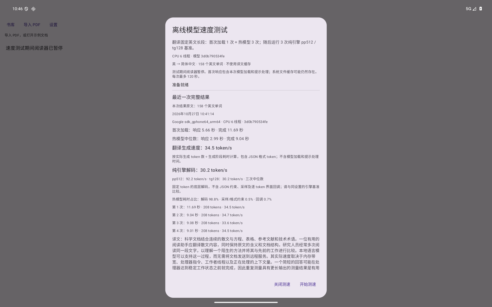
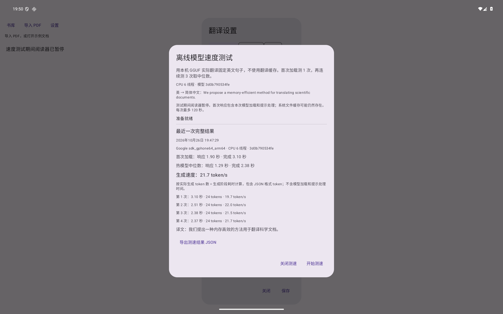

# In-app speed test — 0.2.0-alpha.3

The table and screenshot below retain the **alpha.2 short-sentence observation**. Current alpha.3 uses the 158-word original `SpeedTest.LONG_SOURCE`, then three pure-engine pp512 → tg128 runs (single sequence, 16-token warmup, ctx4096/batch512/ubatch128). Exports add native decode, sampling/grammar and callback intervals. Method version 2 loads historical method-1 reports without relabeling their source. See [the new format matrix and performance investigation](model-compatibility.md) and [the new Android raw results](app-speed-test-android-alpha3.json).



## Historical alpha.2 method and observation

Open **设置 → 离线 GGUF → 速度测试**, then tap **开始测速**. Download or import a model first. The test uses the thread count currently entered in Settings without saving that edit. It always runs the local GGUF engine, including when the reader previously used another provider or target language.



## What is measured

The fixed, original input is “We propose a memory-efficient method for translating scientific documents.” The target is Simplified Chinese, with thinking disabled, an empty glossary, a 4,096-token context, and CPU inference. Benchmark sampling constrains the JSON result to exactly one `s1` translation. Output still passes the structured-result validator and a Chinese-text check; failures do not produce a successful report.

A new provider loads the installed model for the first call. Three further calls reuse that model. All four bypass the translation cache and reset the inference context. The three warm observations are summarized by their median. No automatic repair or retry is hidden inside a sample. Each call has a 120-second timeout.

- **First response:** monotonic elapsed time to the first non-empty UTF-8 stream delta. The first call includes model loading. A delta can be JSON syntax rather than a translated word.
- **Completion:** monotonic elapsed time until the provider finishes streaming. Result validation follows this interval. Reader suspension, previous-model release, report persistence and PDF rendering are outside it.
- **Generation speed:** actual non-EOS tokens sampled by llama.cpp divided by the native generation interval. The interval includes sampling, callbacks and token decoding; it excludes model loading, prefill and sampler construction. Tokens include the JSON envelope. Stream callback counts are never used as token counts.
- **First use:** a fresh model instance; OS file caches are left intact. This is not a cold-storage benchmark.

The reader is unmounted and its provider is closed before testing. Starting the test waits for that provider's native executor to release its model. Cancellation and normal completion also wait for native release before the reader can reopen. An activity recreation retains the test job. Completed results persist locally; a cancelled or failed test keeps the previous complete result. JSON export uses Android's file picker and includes every sample, model SHA-256, bytes, thread counts, app/engine version, device and timestamp. It contains the fixed test sentence rather than document contents or API settings.

## Android observation

Recorded **26 October 2026**, API 36 ARM64 `ranchu` emulator on an Apple M1 Pro host, 8 vCPUs, 6 GiB RAM, CPU inference at 6 threads. Tablet layout was checked at 2560 × 1600 / 240 dpi. This is an emulator observation, not a physical-tablet performance claim.

| Case | First response | Completion | Generation speed |
| --- | --- | --- | --- |
| Fresh model instance | 1.90 s | 3.10 s | 19.7 token/s |
| Warm model, median of 3 | 1.29 s | 2.38 s | 21.7 token/s |

All four samples generated 24 tokens and validated as a single Chinese translation. See the full [raw JSON](app-speed-test-android.json). This fixed short workload does not establish full-document throughput, sustained thermal performance, or translation quality. Earlier host and queue reference measurements use different workloads; see [benchmark methodology](../benchmarks.md).

## Verification

- [Four new core tests](app-speed-test-core.xml): four actual provider calls, native counts independent of stream event counts, warm median and JSON round trip, rejection of invalid output/missing metrics/incomplete reports, and cancellation cleanup. The full core suite passed 28 tests.
- [Three Android tests](app-speed-test-ui.txt): missing-model entry disabled; real Qwen3 four-sample UI run, activity recreation, cancellation preserving the complete result, persistence/export entry, reader pause and resume; cancelled caller finishes model release.
- [Nine existing Android regressions](app-speed-test-regression.txt): reader/cache/annotation recovery, model management, CPU settings, and whole-document recovery.
- [Host JNI regression](app-speed-test-host.json): all four existing real-model cases passed after the JNI metrics change, including cancellation followed by successful inference. These calls retain the reader's ordinary multi-result grammar.
- Actual JSON export was saved through Android `ACTION_CREATE_DOCUMENT` into Downloads and parsed back; it matched the four samples and metadata exactly. Portrait layout was checked at 1600 × 2560 / 240 dpi.
- Debug APK assembly and Android lint passed. APK signature, ZIP/ELF 16 KiB alignment, sole original sample, absence of bundled GGUF, and retained notices passed distribution checks.

Reproduce the opt-in UI check after building/installing both APKs and placing the pinned GGUF in the app's private storage:

```sh
adb shell am instrument -w -r \
  -e class org.pararead.android.SpeedTestUiTest \
  -e ggufPath /data/user/0/org.pararead.android/files/models/speed-test.gguf \
  -e cpuThreads 6 \
  org.pararead.android.test/androidx.test.runner.AndroidJUnitRunner
```

Without `ggufPath`, the real-model UI case is skipped; the missing-model and release-cleanup checks still run. Use a test device: integration checks alter app settings and use the bundled reading sample.
