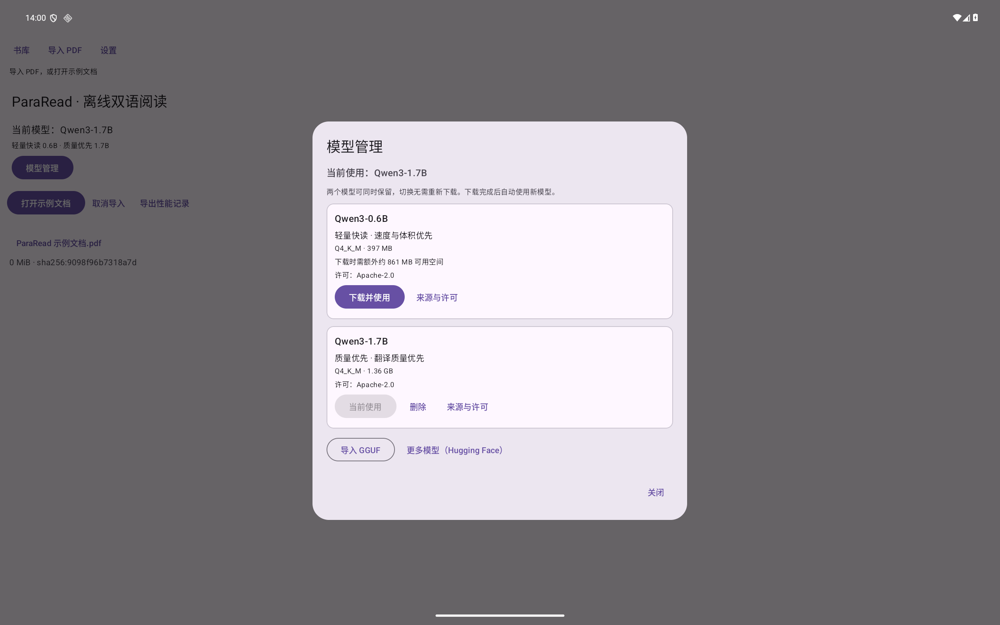

# 模型选择、下载与删除改进（alpha.6）

日期：2026-10-27。首页和“设置 → 离线 GGUF”现在都提供“模型管理”。用户直接选择两个已实测的 Q4_K_M 文件，无需先理解 Hugging Face 仓库和量化列表。

| 卡片 | 下载量 | 用途 | 来源 |
| --- | ---: | --- | --- |
| Qwen3-0.6B | 397 MB | 轻量快读 | Unsloth GGUF，固定提交和 SHA-256 |
| Qwen3-1.7B | 1.36 GB | 质量优先 | 原有 Ollama registry 固定摘要；无需安装 Ollama |

0.6B 的确切文件、提交和摘要沿用[模型实测清单](tiny-model-recovery-manifest.json)首项。两个模型均标注 Apache-2.0，卡片提供来源与许可链接，并在下载前显示额外可用空间需求。0.6B 固定下载 URL 的 HEAD 请求返回 200、396,705,472 字节；本次没有重新完成两个生产 CDN 的全量下载，不把 fixture 下载当作外网下载测速。

## 最终行为

- **两个模型可以同时保留。** 下载和导入完成后自动使用新模型，原有模型保留在本机。列表也显示其他下载或导入的模型。
- **已下载模型离线切换。** 点击“使用”只切换本机选择、名称和许可等元数据，不重新下载；首页和离线设置显示当前模型名称。阅读器重建前会等待旧本地 provider 释放。
- **分别删除。** 点击某张卡片的“删除”后，确认框显示名称和将释放的空间。删除非当前模型不改变选择；删除当前模型清空选择，由用户选择其他模型。PDF、译文缓存、阅读进度和原始导入文件保留。
- **重试原模型。** 下载目标及其来源、版本、大小和摘要在开始前持久化。失败后点击“重试此模型下载”，包括重建管理器后，仍然下载原目标。导入、删除和切换失败不会提供误导的默认模型下载重试。
- **保留取消和后台监控。** 下载仍由 Android DownloadManager 执行。取消只清理暂存文件，不再清理其他已保存模型；文件完整性校验与原子发布仍沿用原流程。
- **旧版原地升级。** 将当前已管理的模型登记到模型库，不复制权重、不重新下载。兼容既有的哈希文件名以及自定义 GGUF 文件名。模型文件路径必须位于应用自己的 models 目录，单个删除不会越出该目录。
- **简化离线设置。** 本地模式不再显示可编辑的“模型名称”；API 模式仍可填写 API 模型名。HF 搜索移到“更多模型”，下载后也保留其他已下载模型。

本次没有修改翻译缓存版本、默认 1.7B 下载、推理线程设置或翻译协议。模型文件大小不等于运行内存；卡片不承诺实体设备速度或译文正确率。

## 验证

[验证元数据](alpha6-verification.json)、[Android 原始记录](model-library-android-tests.txt)、[构建与 lint 输出](model-library-build.txt)。

- Core：43 项通过，覆盖单独删除与暂存清理保留其他权重，以及既有完整性校验和取消行为。
- API36 ARM64 模拟器：19 项中的 17 项通过、2 项按设计跳过。通过项包括下载监控重建、失败摘要、取消、导入、旧文件名迁移、保留多模型、切换、当前/非当前删除、重开后正确重试、三项模型管理 UI、HF 入口、线程设置、测速无模型状态与释放，以及阅读器持久化回归。
- 两个跳过项是需显式参数的 HF 实网下载、完整真实模型测速 UI；不计为通过。阅读器回归使用 mock 翻译并检查 JNI 库加载，本次不据此声称重新验证了真实译文质量或天玑 9400 性能。
- 16 项源码契约检查通过；Debug APK、测试 APK 和 Android lint 通过。检查 APK 签名、16KiB 对齐、无 GGUF、仅包含原创示例 PDF 和许可文件；alpha.6 与 alpha.5 的签名证书一致。
- 平板界面检查：2560×1600、240dpi，确认两张卡片、当前使用状态、下载量、删除入口和来源许可链接可见；截图中的 1.7B 是从旧模型文件原地迁移的状态。

测试使用隔离目录和本机 GGUF fixture 验证 Android 下载/校验行为。有关先前真实权重推理及格式限制，见[模型实测](small-model-evaluation.md)与[格式恢复](format-recovery.md)。
