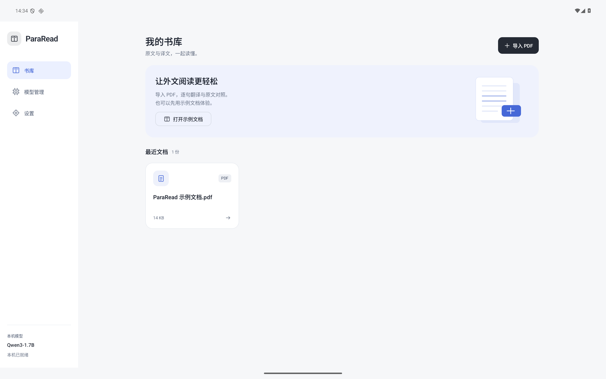
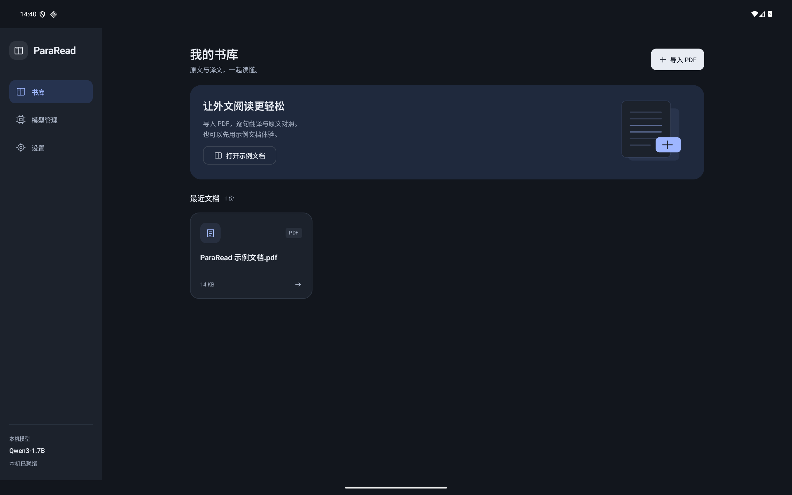
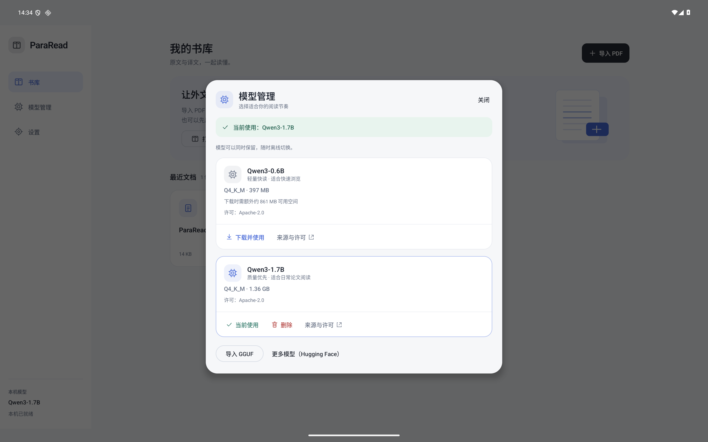
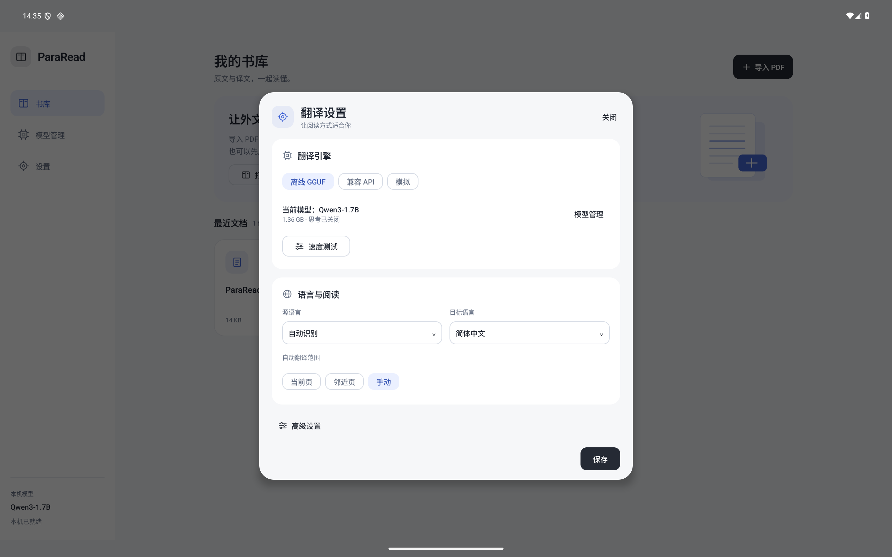
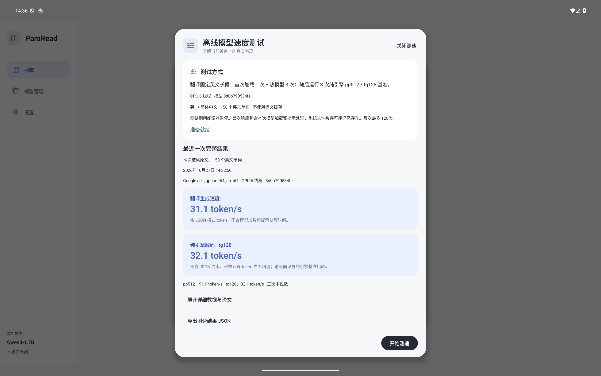

# 界面改进（alpha.7）

日期：2026-10-27。采用浅灰背景、白色卡片、深色标题和少量蓝色强调，减少按钮与表单的拥挤感。视觉方向参考 [PocketPal 官方项目](https://github.com/a-ghorbani/pocketpal-ai)的模型页；图标、插画和布局均为 ParaRead 自行绘制，没有引入 PocketPal 的源代码、图片或字体。

## 书库与导航

宽屏提供侧栏和自适应文档网格；阅读时侧栏缩窄，为 PDF 留出更多空间。窄屏使用顶部导航和单列文档卡片。“导入 PDF”是明确的主操作，示例文档单独提供入口。文档卡片显示名称、格式和可读的文件大小，隐藏内部版本摘要。

## 模型与设置

模型管理统一卡片和按钮样式；已选模型以边框和状态条标示。推荐的 0.6B / 1.7B、来源许可、下载空间提示、切换、删除确认、导入、HF 搜索和失败重试继续可用。

设置按“翻译引擎”“语言与阅读”分组。语言选择直接显示名称，目标语言的 auto 标为“跟随系统”。线程数、每批句数、术语表与性能记录位于“高级设置”。保存和关闭按钮固定在面板边缘，长内容可滚动。

测速页用两张卡片突出显示翻译生成速度和 tg128。完整样本、耗时拆分和译文放在可展开的详细区域，保留 JSON 导出。

截图中的测速数值来自模拟器已保存的真实模型结果，用于核对显示，不是天玑 9400 的成绩。浅色与深色主题随 Android 系统切换；PDF 页面仍保持其原有纸张内容，不进行反色处理。

## 验证范围

检查平板横屏 2560×1600 / 240dpi、窄屏 1080×2400 / 420dpi 的布局，以及平板深色模式。人工核对书库、模型页、设置、语言菜单、高级设置、测速结果展开/收起、HF 搜索入口和阅读工具栏；没有使用静态网页代替 Android UI 截图。

[构建与 lint](ui-build.txt)、[Android 回归原始记录](ui-android-tests.txt)、[真实模型测速 UI 原始记录](ui-speed-real-tests.txt)、[APK 校验元数据](alpha7-verification.json)。

- Core 43 项结果保留有效，Gradle 判定 up-to-date；本次没有修改 core。16 项源码契约检查重新通过。
- Android 窄屏回归 19 项：17 项通过、2 项按设计跳过，覆盖模型下载/切换/删除、HF 入口、无模型测速状态、阅读器缓存/批注/重开。
- 随后在平板深色模式显式提供 Qwen3-1.7B Q4_K_M 和 6 线程，完整测速 UI 3 项全部通过，包括真实翻译四次、pp512/tg128 三次、旋转、取消、结果持久化、导出入口、阅读器暂停与恢复。其中两项与前一轮重合，不能简单相加作为独立测试数；HF 实网完整下载未重测。
- Debug APK、测试 APK、lint 通过（0 errors、40 warnings）。APK 签名与 alpha.6 相同，ELF 与 APK 16KiB 对齐通过，无 GGUF、仅包含原创示例 PDF 和所需许可。本次没有修改推理后端、模型权重、翻译协议或缓存版本，不据此宣称性能或翻译质量提升。实体平板、TalkBack 和大字体的全面适配仍需验证。
