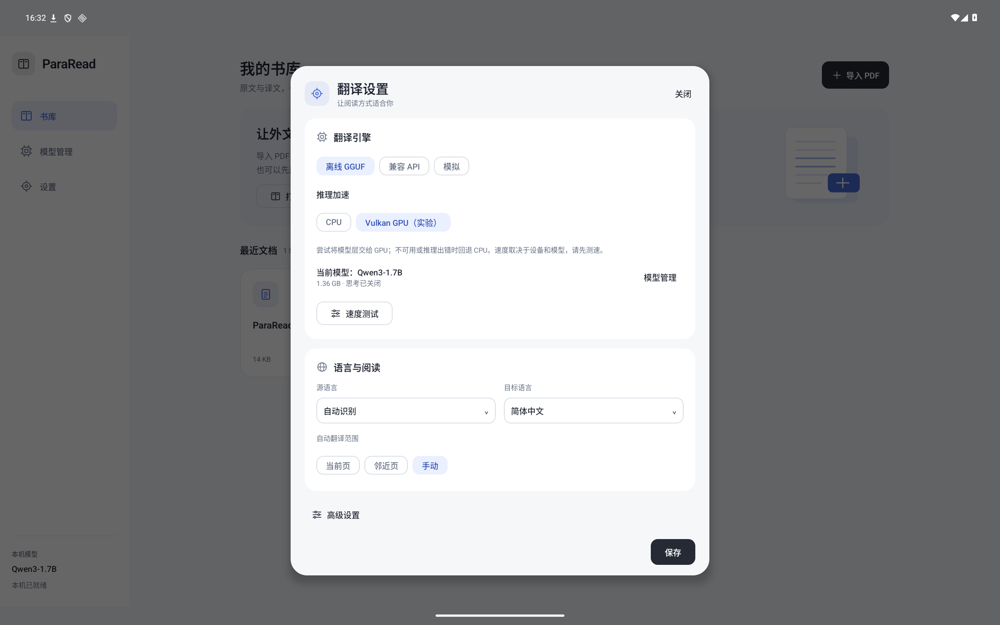
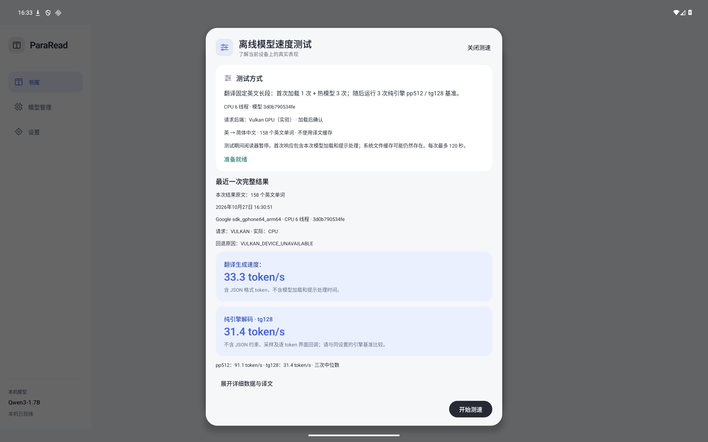

# Vulkan experimental backend verification

Date: 2026-10-27. Version: 0.2.0-alpha.8. [Machine-readable verification](alpha8-verification.json).

CPU is the default. Vulkan is an opt-in plugin using the same pinned llama.cpp revision and supported GGUF files. The app attempts all model layers on one Vulkan device, validates a real model warmup, and reports the actual backend. CPU contexts explicitly disable GPU offload.

## Validation and limits

- 44 core unit tests, including GPU draft restart → CPU result → validated cache commit.
- 8 engine boundary tests: CPU default, successful GPU metadata/cleanup, initialization fallback, decode fallback with partial-output reset, no retry after cancellation, finite CPU failure, discarded GPU benchmark failure, and cancellation of a provider waiting for another GPU session to finish. GPU success/error cases here use an injected runtime; they are not hardware GPU tests.
- 21 scheduled Android regression cases: 19 passed, 2 opt-in real-model cases skipped. Settings persistence, unchanged cache identity, interrupted-session recovery, model manager/library/catalog and reader integration passed (26.051 seconds).
- Real Qwen3-0.6B Q4_K_M: CPU translation and pp32/tg8; requested Vulkan correctly falls back to CPU with `VULKAN_DEVICE_UNAVAILABLE`; a subsequent CPU session succeeds. [Native result](vulkan-native-result.json), [log](vulkan-native-tests.txt).
- Real Qwen3-1.7B Q4_K_M, six threads: full speed UI workflow passed 3/3 tests in 75.895 seconds. Requested Vulkan, actual CPU fallback; four translations plus three pp512/tg128 samples, rotation, cancellation, persisted result and export entry passed. [Report](vulkan-speed-result.json), [log](vulkan-speed-tests.txt). Two of these tests overlap the standard regression suite.
- Source contracts: 16 passed. Build and lint passed: zero errors, 41 warnings. [Build log](vulkan-build.txt), [Android regression log](vulkan-android-tests.txt).
- APK verified for ARM64, 16 KiB ELF and ZIP alignment, existing debug signing certificate, required backend libraries, original sample only, no GGUF weights and bundled license notices.

All Android evidence above uses the API 36 ARM64 emulator (8 virtual CPUs, 6 GiB, SwiftShader). Its Vulkan device lacks 16-bit storage support; the model tests establish fallback correctness, **not successful hardware Vulkan inference or a Dimensity 9400 speedup**. The report's throughput values are emulator CPU measurements.

Native driver crashes/aborts cannot be caught in-process. The persistent active-session marker restores CPU on the next launch; an OS kill can cause the same conservative recovery. Activity recreation shares one process-level native model owner and does not reset the backend preference. See [usage and fallback rules](../vulkan.md).

## Actual Android UI

Vulkan selection:

Requested Vulkan and actual CPU fallback in the persisted speed report (emulator):

